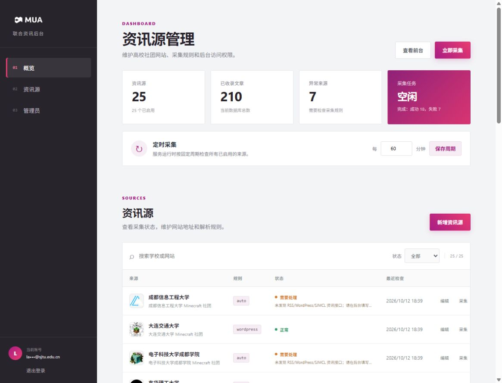

# MUA 高校社团联合资讯

高校 Minecraft 社团官网资讯聚合站，提供公开页面、采集后台和 SJMCL 兼容接口。技术栈为 Node.js、Express、MySQL。




## 功能

- 内置 25 所高校来源，支持 RSS、WordPress、SJMCL、HTML 和 JSON。
- 定时采集；后台可维护来源、采集规则和管理员。
- 使用 MUA 用户中心 OAuth 登录。
- `/api-sjmcl/article` 输出 SJMCL 兼容数据，标签包含学校名称。

## 服务器部署

适用于安装了 Node.js 20.18+、Docker Compose 和 Nginx 的 Ubuntu/Debian 服务器。

```bash
sudo git clone https://github.com/zaixiZaixiSJTU/MUA_union_news.git /opt/mua-union-news
cd /opt/mua-union-news
sudo npm ci --omit=dev
sudo cp .env.example .env
sudo editor .env
```

至少设置以下变量：

| 变量 | 说明 |
| --- | --- |
| `BASE_URL` | 公网 HTTPS 地址，填写 `https://www.mualliance.cn/news` |
| `DATABASE_URL` | MySQL 连接地址，密码与 `MYSQL_PASSWORD` 一致 |
| `MYSQL_PASSWORD` / `MYSQL_ROOT_PASSWORD` | MySQL 密码 |
| `SESSION_SECRET` | 随机会话密钥 |
| `OAUTH_CLIENT_ID` / `OAUTH_CLIENT_SECRET` | 同一个 MUA OAuth 应用的凭据 |
| `ADMIN_EMAILS` | 首次导入的管理员邮箱 |

OAuth 回调地址设置为：

```text
https://www.mualliance.cn/news/auth/callback
```

启动 MySQL：

```bash
sudo docker compose up -d mysql
```

创建 `/etc/systemd/system/mua-union-news.service`：

```ini
[Unit]
Description=MUA Union News
After=network-online.target docker.service

[Service]
User=www-data
WorkingDirectory=/opt/mua-union-news
ExecStart=/usr/bin/node src/server.js
Restart=always
Environment=NODE_ENV=production

[Install]
WantedBy=multi-user.target
```

```bash
sudo chown -R www-data:www-data /opt/mua-union-news
sudo chmod 600 /opt/mua-union-news/.env
sudo systemctl daemon-reload
sudo systemctl enable --now mua-union-news
```

将 [`deploy/nginx-news-location.conf`](deploy/nginx-news-location.conf) 中的两个 `location` 添加到 `www.mualliance.cn` 现有 WordPress 站点的 `server` 块：

```nginx
location = /news {
    return 308 /news/;
}

location ^~ /news/ {
    proxy_pass http://127.0.0.1:3000/;
    proxy_http_version 1.1;
    proxy_set_header Host $host;
    proxy_set_header X-Real-IP $remote_addr;
    proxy_set_header X-Forwarded-For $proxy_add_x_forwarded_for;
    proxy_set_header X-Forwarded-Proto $scheme;
    proxy_set_header X-Forwarded-Prefix /news;
}
```

检查并重载 Nginx：

```bash
sudo nginx -t
sudo systemctl reload nginx
```

生产地址为：

- 首页：`https://www.mualliance.cn/news/`
- 后台：`https://www.mualliance.cn/news/admin`
- API：`https://www.mualliance.cn/news/api-sjmcl/article?pageSize=12`

## SJMCL API

```text
GET /api-sjmcl/article?pageSize=12
GET /api-sjmcl/article?pageSize=12&cursor=12
GET /api-sjmcl/article?pageSize=0
```

返回 `sourceInfo`、`posts` 和 `next`。`pageSize=0` 只返回来源信息。格式参考[发现页官网文章接口](https://notes.sjtu.edu.cn/LD9Y-X7dRxaq_Q7rW7PNcw)。

## 更新与检查

```bash
cd /opt/mua-union-news
sudo -u www-data git pull --ff-only
sudo -u www-data npm ci --omit=dev
sudo systemctl restart mua-union-news
sudo journalctl -u mua-union-news -f
```

默认每 60 分钟采集一次，后台可调整为 15–1440 分钟。`ADMIN_EMAILS` 只在管理员表为空时导入，之后在后台热增删。
